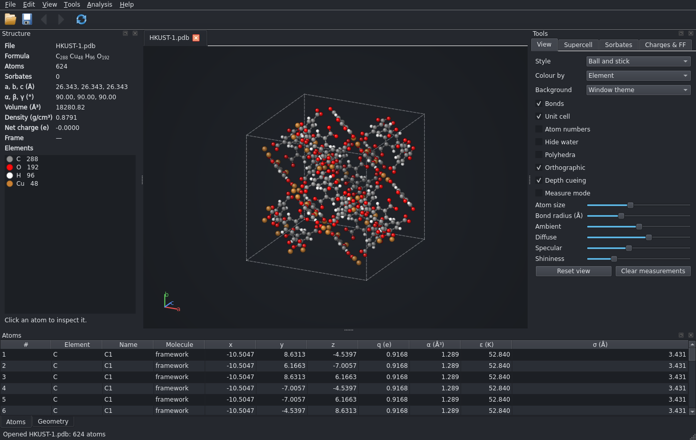
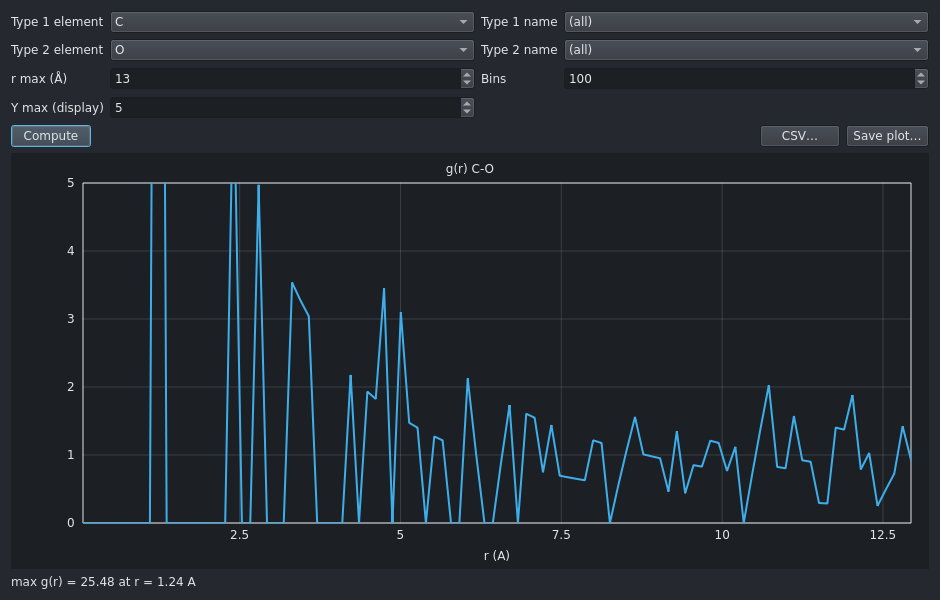

# PDB Wizard

[](https://github.com/space-group-research/pdb_wizard/actions/workflows/tests.yml)

Structure handling for porous-materials simulations: read, clean up, extend and inspect
crystal structures, assign force fields and charges, pack sorbate molecules, and write
inputs for MPMC, CP2K, CRYSTAL23, OpenMM and LAMMPS. It runs as a desktop window, an
interactive 3D terminal viewer, a classic text menu, or a batch command-line tool. The three
interactive front ends have the same features and give the same numbers.

Developed in the [Space group](https://drbrian.space) at NC State University.

## Install

```bash
pip install "pdb-wizard[viewer,gui,symmetry] @ git+https://github.com/space-group-research/pdb_wizard"
```

Python 3.9 or newer. The only required dependency is NumPy; the extras are optional:

| Extra | Adds | Without it |
|---|---|---|
| `viewer` | [textual](https://textual.textualize.io) and Pillow: the terminal viewer | `pdb_wizard file` falls back to the classic menu |
| `gui` | PySide6 and Pillow: the desktop window (`--gui`) | `--gui` prints how to install it |
| `symmetry` | [spglib](https://spglib.readthedocs.io): Find Symmetry and symmetry-reduced CRYSTAL23 inputs | CRYSTAL23 inputs are written in P1 |

A single-file version, `pdb_wizard.py`, needs only NumPy. Build it with `python build.py`
(written to `dist/`); the group ships it in
[space-group-environment](https://github.com/space-group-research/space-group-environment).

## Use

```bash
pdb_wizard --gui structure.cif      # desktop window (Qt; needs the gui extra, PySide6)
pdb_wizard structure.cif            # 3D terminal viewer (textual)
pdb_wizard --classic structure.pdb  # the original text menu
pdb_wizard structure.pqr --info     # batch: formula, cell, density
pdb_wizard in.cif --convert -o out.pqr   # batch: convert (.pqr = MPMC format)
pdb_wizard --help                   # all batch options (--rdf, --msd, --surface, --psd, ...)
```

Reads PDB (standard, pdb2pqr and MPMC dialects), CIF, XYZ, POSCAR, LAMMPS data, SDF, MOL2,
Gaussian, Z-matrix, CRYSTAL output (`.out`), DCD and multi-frame PDB/XYZ trajectories. Writes
XYZ, PDB, MPMC, CIF, POSCAR, LAMMPS data and CRYSTAL23 `.d12`.

### Before you simulate: Check Structure

*Analysis > Check Structure* (classic menu: 11, then 15) looks for the mistakes that give a
wrong simulation without an error message. It never changes the structure.

- A CIF that names a space group but lists no symmetry operators is read as P1, so you only
  have the asymmetric unit. Partially occupied and disordered sites are all kept as full
  atoms. Both are reported when the file is opened and again in the check.
- Atoms closer than 0.7 Å, no hydrogens on an organic framework, unknown elements.
- No charges, a net charge, or elements the force field has no parameters for.
- A cell too small for a 10 Å cutoff, with the supercell that fixes it.
- Open-shell metals (the generated CP2K input is closed-shell: add `UKS` and a
  `MULTIPLICITY`).
- A Monte Carlo trajectory: MSD and RMSD on one are not physical, and say so.

Other guard rails: *Delete Lone Atoms* shows what it would remove and warns when that
includes framework metals (it finds all 48 Cu in HKUST-1, because metal-ligand bonds are
longer than its contact test); the isotherm plot also lists MPMC's own N, wt% and Qst with
error bars from the run logs and names runs that have not finished; the OpenMM generator
warns that the stock Amber force fields have no templates for a framework.

QEq charges are a quick estimate. In test runs on HKUST-1 they were about half the size of
DFT-derived charges, which is too weak for polar sorbates such as CO2. Use fitted charges
(for example CP2K RESP, which can be loaded directly from the `.resp` file) for production
work.

### CRYSTAL23

*Save as CRYSTAL23 .d12* (classic menu: 13, then 7) writes a complete cell-optimisation
input from the group's template (HSE06/POB-TZVP-REV2). You are asked for a space group:

- `1` writes every atom in P1. Always valid, and the most expensive way to run CRYSTAL.
- A number from *Analysis > Find Symmetry* writes only that group's asymmetric unit in the
  conventional cell. HKUST-1 goes from 624 atoms to 6 in Fm-3m (225).

*Find Symmetry* searches at a ladder of tolerances and lists each space group with the
tolerance that finds it and how far atoms have to move to fit it exactly, so an approximate
symmetry is not mistaken for a real one. The geometry block follows the CRYSTAL manual
(minimal cell parameters per crystal system, hexagonal axes for rhombohedral groups, unique
axis b, and the origin flag set for groups with two origin settings). It has been checked
against the manual's examples but not yet against a CRYSTAL run: try one small job first.
A CRYSTAL `.out` opens as the final geometry in the primitive cell.

### Classic menu

`--classic` keeps the original numbered menu, and the original numbers never change (main
menu 1-10, geometry menu 1-9), so input scripts written for the old `pdb_wizard.py` still
work. Everything newer is appended: 11 analysis, 12 edit, 13 other formats and pictures,
14 simulation inputs, 15 isotherm results, 16 database, 17 undo, 18 open another file.

### Desktop window





`pdb_wizard --gui` has everything the terminal viewer has, in windows and menus:

- **View**: ball and stick, licorice, space filling or protein ribbon; colour by element,
  charge, residue, chain or index; atom numbers, hidden water, coordination polyhedra,
  perspective or orthographic, dark or light background, lighting and size sliders. Drag to
  rotate, right-drag to pan, wheel to zoom; the terminal viewer's keys work too (`v`, `C`,
  `#`, `w`, `P`, `O`, `m`, `t`, `c`, `r`, `,`/`.`).
- **Measure**: in measure mode two clicks pin a distance; shift-click two, three or four
  atoms for a distance, angle or dihedral. *Help > Keyboard and mouse* (F1) lists every
  control.
- **Tabs and trajectories**: each file opens in a tab; multi-frame PDB/XYZ and DCD files
  get a frame slider with play, speed and "open frame in new tab".
- **Edit** (with undo and redo): wrap, sort, supercells and reducing them back (choosing which
  sorbates to keep), delete lone atoms, set X–H distances, update or remove the cell,
  substitute elements, edit coordinates, QEq or file charges, force fields, and sorbate
  packing.
- **Analysis**: system info, void volume, surface area, pore sizes, RDF, coordination
  numbers, H-bonds, MSD and diffusion constants, RMSD, radius of gyration, density
  profiles, 3D density maps, powder XRD (with an experimental overlay), MPMC energy.dat
  and isotherm plots, each with CSV and PNG export.
- **Tools**: the input generator (MPMC isotherms, CP2K, OpenMM), structure database
  search (COD, RCSB PDB, PubChem, Materials Project) and a geometry panel listing bonds,
  angles, dihedrals, contacts, molecules and lone atoms.
- **Export**: PNG and rotation GIF.

Both front ends run the same analysis and input-generator code, so they report the same
numbers (the test suite checks this). The window is drawn with Qt's painter rather than
OpenGL, so it also works over SSH X forwarding. It uses the desktop's own style on KDE
(Breeze) and a dark Fusion theme elsewhere. *Save as* picks the format from the extension
(`.pqr` = MPMC). It needs PySide6, the package's `gui` extra.

### Packing sorbates for MPMC

The *Sorbates* tab in the desktop window, *Edit > Pack Sorbates* (or *Save as MPMC PDB*)
in the terminal viewer, or option 10 in the classic menu packs N copies of a
sorbate (or fills the cell) at random positions and orientations. Overlaps are checked with
the minimum image in the actual (monoclinic or triclinic) cell, against the framework and
against each other. Built-in models include TIP3P, TIP4P, TIP5P, SPC/E, DC97 and POL3 water,
H2, CO2, CH4, N2, O2 and noble gases (LJ, polarizable and PHAHST); any MPMC `.pqr` molecule
can be used as a template. MPMC files that already contain sorbates keep them movable when
re-saved, and force fields or charges applied afterwards only touch the framework.

Random packing is a starting point, not an equilibrated state: relax it in MPMC (NVT) before
starting μVT from it.

## Tests

```bash
pip install -e ".[viewer,gui,symmetry,test]"
QT_QPA_PLATFORM=offscreen pytest -n auto
```

GitHub Actions runs this on Python 3.9 and 3.12 for every push and pull request, and
checks that the single-file build runs with NumPy alone.

Optional suites:

| Option | Runs |
|---|---|
| `--mpmc /path/to/mpmc` | MPMC itself on files pdb_wizard writes (energies, GCMC start-up) |
| `--baseline REF` | differential regression tests against a git ref or a built `pdb_wizard.py` (default `main`; skipped when identical) |
| `--corpus DIR` | the regression tests over every structure under `DIR` (e.g. MPMC's `tutorials_and_examples`) |

The test run builds `dist/pdb_wizard.py` first, so the single-file version is tested too. The
desktop-window tests run headless (`QT_QPA_PLATFORM=offscreen`) and skip without PySide6 and
pytest-qt. `tests/test_gui_parity.py` runs every analysis in both the desktop window and the
terminal viewer and requires identical results, and fails if a terminal-viewer operation has
no desktop counterpart; `tests/test_classic_parity.py` does the same for the classic menu.
`tests/test_workflows_e2e.py` runs whole workflows (CIF to an MPMC framework, an isotherm set
up, run and plotted, CP2K and OpenMM inputs) through all three front ends and compares the
files they write.

## License

GPL-3.0-or-later (see [LICENSE](LICENSE)). The terminal viewer, renderer and Z-matrix reader
are adapted from [moltui](https://github.com/kszenes/moltui) by Kalman Szenes (MIT); see
[THIRD_PARTY_LICENSES](THIRD_PARTY_LICENSES).
